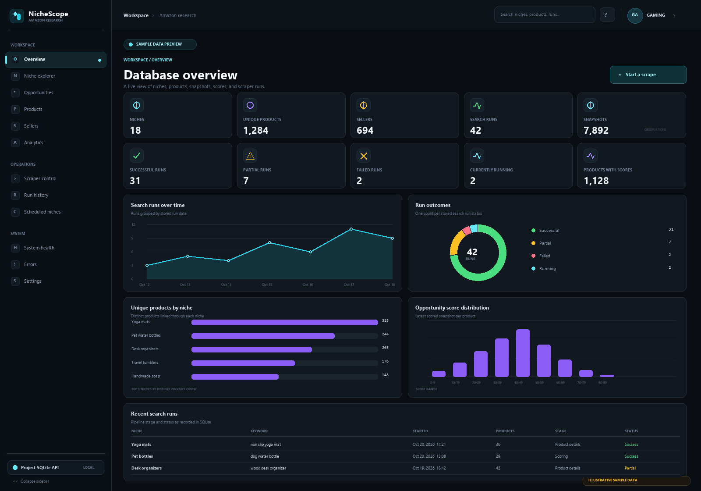
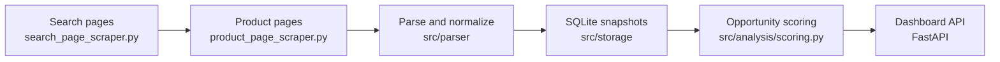

<<<<<<< HEAD
# NicheScope

Amazon product research and analytics for exploring a niche, tracking product snapshots, and comparing potential opportunities. NicheScope collects Amazon India (`amazon.in`) search and product details, stores each run in SQLite, scores the results, and presents them in a local dashboard.

[](https://github.com/kharatatva/amazon_data_scaper_and_analytics/actions/workflows/ci.yml) [](LICENSE) [](https://www.python.org/downloads/)



*Dashboard preview with illustrative sample data.*

## What it does

- Collects Amazon search results and selected product details with Playwright.
- Parses listings into product and time-stamped snapshot records in SQLite.
- Scores demand, review concentration, listing quality gaps, and overall opportunity.
- Provides a FastAPI service and React dashboard for products, sellers, niches, runs, schedules, and analytics.
- Runs the same scraping, parsing, and scoring pipeline from the command line or dashboard.

## Pipeline



Each pipeline run has a `search_run_id` that ties together its products, snapshots, scores, and errors. Search-page HTML is saved under `data/rendered_html/` for local recovery and diagnostics; the `data/` directory is excluded from Git except for its placeholder file.

## Requirements

- Python 3.13
- Node.js and pnpm 10.4.1 for the dashboard
- Chromium installed through Playwright

## Quick start

The commands below use PowerShell. A live scrape sends requests to Amazon and validates public proxies; the dashboard and offline test suite do not scrape.

```powershell
git clone https://github.com/kharatatva/amazon_data_scaper_and_analytics.git
Set-Location amazon_data_scaper_and_analytics
py -3.13 -m venv .venv
.\.venv\Scripts\Activate.ps1
python -m pip install -r requirements.txt
python -m playwright install chromium
python -m src.storage.init_db
python -m src.storage.migrations
```

Run a scrape by supplying a niche and search keyword:

```powershell
python scripts/run_full_pipeline.py --niche "desk accessories" --keyword "desk organizer" --pages 1 --products 10
```

The pipeline supports up to 10 search pages per run. If you omit the niche, keyword, or page count, it prompts for them. Use `--run-id <id> --pages <count>` to resume an existing run.

## Start the dashboard

Start the API from the project root:

```powershell
python -m uvicorn src.storage.backend.main:app --host 127.0.0.1 --port 8000
```

In another terminal, start the launcher-selected frontend:

```powershell
Set-Location nichescope-phase9
pnpm install --frozen-lockfile
pnpm exec vite --host 127.0.0.1 --open
```

Open the Vite URL shown in the terminal (by default, `http://localhost:3000`). The frontend sends `/api` requests to the local FastAPI service. The API has no application login; keep it on localhost unless you add authentication.

## Scoring

- **Demand** combines normalized review count (70%) and review velocity (30%). Velocity uses dated observations and is unavailable until there are at least two valid points.
- **Competition** measures how concentrated review counts are among the top three products. A higher score means reviews are spread more evenly across the niche.
- **Quality gap** combines review count, rating, and listing evidence. It favors established products with room to improve their ratings or listings.
- **Opportunity** combines demand, competition, and quality gap with weights of 0.4, 0.3, and 0.3. Missing signals are omitted and the available weights are renormalized.

See [src/analysis/scoring.py](src/analysis/scoring.py), [src/config.py](src/config.py), and the [architecture notes](docs/ARCHITECTURE.md#scoring-and-storage) for implementation details.

## Configuration

Scraper and scoring defaults live in `src/config.py`; the Python application does not load the root `.env` file. Common settings include:

| Setting | Default | Description |
| --- | ---: | --- |
| `MAX_PAGES_TO_CRAWL` | `10` | Maximum search pages in one run. |
| `MAX_DETAIL_PAGES_PER_RUN` | `100` | Maximum product detail pages selected for a run. |
| `SEARCH_PAGE_CONCURRENCY` | `7` | Concurrent search-page tasks. |
| `PRODUCT_PAGE_CONCURRENCY` | `10` | Concurrent product-detail tasks. |
| `MAX_RETRIES` | `3` | Total fetch attempts, including the first. |
| `HEADLESS` | `False` | Whether to launch Chromium without a visible window. |
| `SCORE_WEIGHTS` | `0.4 / 0.3 / 0.3` | Demand, competition, and quality-gap weights. |

The optional frontend settings in [.env.example](.env.example) are for analytics, login URL helpers, or retained integrations. Copy it to `nichescope-phase9/.env` only when configuring those features. Values beginning with `VITE_` are bundled into browser code and must not contain secrets.

## Development

Install the offline development tools and run the checks from the repository root:

```powershell
python -m pip install -r requirements-dev.txt
ruff check
pytest -q
```

The tests use temporary databases and synthetic HTML; they do not scrape Amazon or use local `data/` files. GitHub Actions runs these checks and type-checks/builds the active frontend.

## Project layout

```text
src/                    Scraping, parsing, scoring, SQLite, and FastAPI code
scripts/                Pipeline, parser/scoring entry points, and schema check
migrations/             Numbered SQLite migrations
tests/                  Offline tests and synthetic HTML fixtures
nichescope-phase9/      React/TypeScript dashboard selected by the launcher
docs/                   Architecture and repository notes
data/                   Local databases, logs, and captured pages (ignored)
```

## Limitations and responsible use

- The marketplace is currently Amazon India (`amazon.in`).
- Proxies are sourced from a free public list and may be unavailable or unreliable.
- The API has no authentication. Keep it bound to localhost.
- Amazon may restrict automated access. Review its terms and applicable laws, keep request rates low, and stop if access is denied. The scraper does not attempt to bypass persistent CAPTCHAs.
- Do not commit credentials, `.env` files, databases, logs, saved Amazon pages, or scraped product data. See [SECURITY.md](SECURITY.md).

Amazon and its affiliates do not sponsor or endorse this project. Use it at your own risk.

## Contributing and license

See [CONTRIBUTING.md](CONTRIBUTING.md) for setup and pull request guidance. This project is licensed under the MIT License; see [LICENSE](LICENSE).
=======
# amazon_scraper
>>>>>>> bc93aa42ef3a35f67299712fc57c31be2541681b
