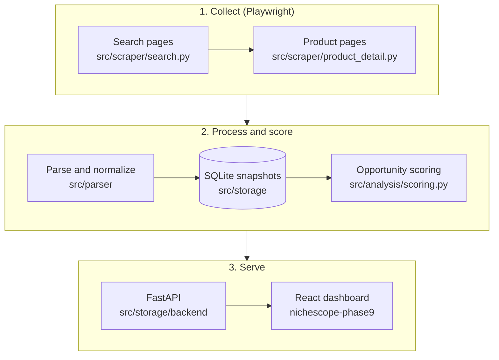
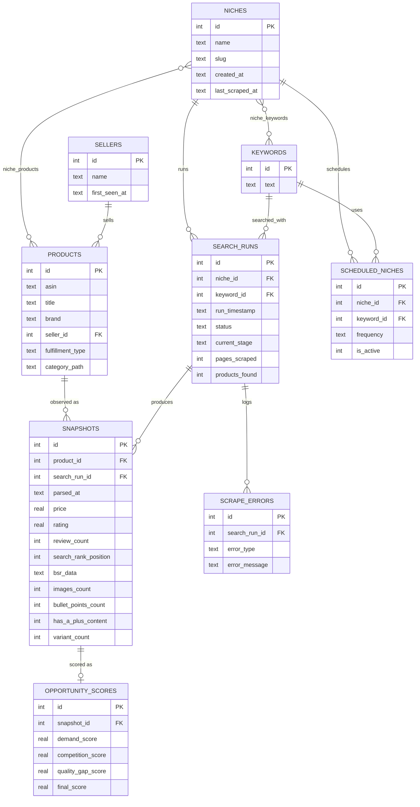

<div align="center">

# NicheScope

**Find Amazon niches worth entering, using data instead of guesswork.**

Scrape Amazon India search results and product pages, store every observation as a time-stamped snapshot,<br>and rank opportunities with a transparent demand, competition and quality-gap score.


[Quick start](#quick-start) &nbsp;·&nbsp; [Dashboard](#dashboard) &nbsp;·&nbsp; [How scoring works](#how-scoring-works) &nbsp;·&nbsp; [Data model](#data-model) &nbsp;·&nbsp; [Status](#project-status) &nbsp;·&nbsp; [Responsible use](#responsible-use)

<br>


</div>

<br>

## Overview

NicheScope answers one question for Amazon sellers and product researchers: **is this niche worth entering, and which products define it?**

A run takes a niche and a search keyword, collects the first pages of Amazon India results, visits a selected set of product pages, and stores everything as time-stamped snapshots in a local SQLite database. Each snapshot is then scored. Everything runs on your machine.

| Track | Compare | Decide |
| :--- | :--- | :--- |
| Every run is stored as snapshots, so price, rating, reviews and rank can be compared over time. | Niches, products and sellers share one data model. | A transparent score combines demand, competition and listing quality gaps. |

## Features

| Capability | Details |
| :--- | :--- |
| **Browser-based collection** | Playwright (with stealth patches) drives Chromium for search pages and product pages, with retries and rotating public proxies. |
| **Structured storage** | Products, sellers, keywords and snapshots in SQLite, managed with numbered migrations. |
| **Opportunity scoring** | Demand, competition and quality gap, combined into one score with configurable weights. |
| **Resumable pipeline** | Every run has a `search_run_id`, a status and a current stage, so progress and failures are traceable. |
| **FastAPI backend** | Read endpoints for niches, runs, ranked opportunities and product history. |
| **React dashboard** | A Vite and React interface. It currently runs on bundled demo data. See [Project status](#project-status). |

## How it works



| # | Stage | What happens | Result |
| :-: | :--- | :--- | :--- |
| 1 | **Search pages** | Fetch up to 10 result pages for the keyword | Ranked product list and saved page HTML |
| 2 | **Product pages** | Visit up to `MAX_DETAIL_PAGES_PER_RUN` products for detail fields | Seller, rank, listing quality and more |
| 3 | **Parse** | Normalize prices, ratings, counts and ranks; de-duplicate ASINs across pages | Product and snapshot records |
| 4 | **Store** | Upsert into SQLite under one `search_run_id` | Rows in `products`, `snapshots` and related tables |
| 5 | **Score** | Compute demand, competition, quality gap and the final score | One row in `opportunity_scores` per snapshot |
| 6 | **Serve** | FastAPI exposes the data on localhost | JSON API |

> [!NOTE]
> Every run has a `search_run_id` that ties together its products, snapshots, scores and errors. Search-page HTML is kept under `data/rendered_html/` for local recovery and diagnostics. The newest `RAW_HTML_RETENTION_RUNS` runs are kept.

### What gets captured

| Source | Fields |
| :--- | :--- |
| **Search results** | ASIN, title, price, rating, review count, search rank position, Sponsored / Amazon's Choice / Best Seller flags, product URL, thumbnail |
| **Product pages** | Brand, seller, fulfillment type, category path, Best Sellers Rank (all listed categories), image count, bullet-point count, A+ content flag, variant count, weight and dimensions |
| **Derived** | Demand, competition, quality-gap and final opportunity scores for each snapshot |

## Quick start

| Requirement | Version |
| :--- | :--- |
| Python | 3.13 |
| Node.js | 20.19 or newer (dashboard only; Vite 7) |
| pnpm | 10.4.1 (dashboard only) |
| Chromium | Installed through Playwright, as shown below |

> [!NOTE]
> The commands use PowerShell; macOS and Linux equivalents follow. A live scrape sends requests to Amazon and fetches a public proxy list. The dashboard does not scrape.

**1. Install**

```powershell
git clone https://github.com/kharatatva/amazon_scraper.git
Set-Location amazon_scraper
py -3.13 -m venv .venv
.\.venv\Scripts\Activate.ps1
python -m pip install -r requirements.txt
python -m playwright install chromium
```

<details>
<summary><b>macOS / Linux</b></summary>

```bash
git clone https://github.com/kharatatva/amazon_scraper.git
cd amazon_scraper
python3.13 -m venv .venv
source .venv/bin/activate
python -m pip install -r requirements.txt
python -m playwright install chromium   # on Linux you may need: --with-deps chromium
```

Later commands are the same on every platform, except `Set-Location` (use `cd`).

</details>

**2. Create the database**

```powershell
python -m src.storage.init_db
python -m src.storage.migrations
```

`init_db` creates the baseline schema (migration `0001`); `migrations` applies every later numbered file in `migrations/` once and records it in `schema_migrations`.

**3. Run your first scrape**

```powershell
python scripts/run_full_pipeline.py
```

The pipeline is interactive. It asks for three values:

| Prompt | Description |
| :--- | :--- |
| `Enter niche` | The niche you are researching, for example `desk accessories`. |
| `Enter keyword` | The Amazon search keyword, for example `desk organizer`. |
| `Enter number of pages to scrape` | Search pages to scrape. Values above `MAX_PAGES_TO_CRAWL` (10) are capped. |

How many product pages are visited is controlled by `MAX_DETAIL_PAGES_PER_RUN` in [`src/config.py`](src/config.py).

You can also run stages separately for an existing run:

```powershell
python scripts/run_parser.py <search_run_id>
python scripts/run_scoring.py
python scripts/verify_schema.py
```

## Dashboard

Start the API from the project root:

```powershell
python -m uvicorn src.storage.backend.main:app --host 127.0.0.1 --port 8000
```

In a second terminal, start the frontend:

```powershell
Set-Location nichescope-phase9
pnpm install --frozen-lockfile
pnpm dev --host 127.0.0.1
```

Open the URL Vite prints (port `3000` is preferred; Vite picks the next free port if it is busy).

| Page | What you can do |
| :--- | :--- |
| **Overview** | See headline numbers across tracked niches |
| **Niches** | Follow a niche, its keywords and its latest runs |
| **Opportunities** | Rank products by opportunity score |
| **Products** | Browse products with price, rating, reviews and rank history |
| **Sellers** | See who sells in a niche and how many products they hold |
| **Analytics** | Compare signals across niches and products |
| **Scraper** | Configure and monitor scrape runs (demo controls for now) |

> [!IMPORTANT]
> The dashboard ships in **demo mode** (`VITE_API_MODE=mock`): it displays bundled sample data and does not read your database yet. The FastAPI endpoints below work on their own and are documented at `http://127.0.0.1:8000/docs` while the API runs.

| Endpoint | Returns |
| :--- | :--- |
| `GET /api/niches` | All niches |
| `GET /api/niches/{niche_id}/runs` | Runs for a niche |
| `GET /api/niches/{niche_id}/runs/{search_run_id}/opportunities` | Ranked opportunities for a run |
| `GET /api/products/{product_id}` | Product detail |
| `GET /api/products/{product_id}/price-history` | Price history |
| `GET /api/products/{product_id}/rank-history?niche_id=` | Rank history within a niche |

> [!WARNING]
> The API has no authentication. Keep it bound to `127.0.0.1`. Its CORS policy currently allows only `http://localhost:5173`.

## How scoring works

Every snapshot receives three signals and one overall score, each from 0 to 1 (higher means a more attractive opportunity). Signals are measured relative to the other products in the same niche run.

| Signal | What it tells you | How it is computed |
| :--- | :--- | :--- |
| **Demand** | How much attention the product already attracts | 70% min-max normalized review count and 30% normalized review velocity, both relative to the niche run. Velocity needs at least two dated observations. |
| **Competition** | How open the niche is to a newcomer | Measures how concentrated review counts are among the top `TOP_COMPETITORS_COUNT` (3) products of the niche run. Reviews spread more evenly give a higher score. |
| **Quality gap** | Room to out-execute established products | 40% review count (as the "established" signal), 35% rating (best near 3.75, inside a 3.3 to 4.2 band) and 25% listing quality (targets: 7 images, 5 bullet points). |
| **Opportunity** | The overall ranking score | A weighted blend of the three signals, shown below. |

```text
opportunity = 0.4 × demand + 0.3 × competition + 0.3 × quality_gap
```

> [!IMPORTANT]
> A missing signal is never counted as zero. When a signal is unavailable, for example velocity before a second run, it is omitted and the remaining weights are renormalized.

Review count feeds both Demand and Quality gap by design, so the signals are correlated. All weights and thresholds live in [`src/config.py`](src/config.py); the logic is in [`src/analysis/scoring.py`](src/analysis/scoring.py).

## Data model



<sub>`niche_keywords` and `niche_products` are junction tables, drawn here as many-to-many links. Some columns are omitted for readability.</sub>

Design notes:

- **One snapshot per product per run.** Re-processing a run updates its rows instead of duplicating them.
- **History by default.** Running a niche again adds new snapshots, which is what makes review velocity and trends possible.
- **Local first.** The database is a SQLite file at `data/scraper_analysis.db`, created by `init_db` and evolved with numbered migrations in `migrations/`.

## Configuration

Scraper and scoring defaults live in [`src/config.py`](src/config.py) as plain Python variables. The Python code does not read a `.env` file.

| Setting | Default | Description |
| :--- | :---: | :--- |
| `MAX_PAGES_TO_CRAWL` | `10` | Maximum search pages in one run. |
| `MAX_DETAIL_PAGES_PER_RUN` | `100` | Maximum product detail pages selected for a run. |
| `SEARCH_PAGE_CONCURRENCY` | `7` | Concurrent search-page tasks. |
| `PRODUCT_PAGE_CONCURRENCY` | `10` | Concurrent product-detail tasks. |
| `MIN_DELAY` / `MAX_DELAY` | `5` / `15` s | Random pause range between requests. |
| `MAX_RETRIES` | `3` | Total fetch attempts, including the first. |
| `HEADLESS` | `False` | Launch Chromium without a visible window. Set `True` on servers without a display. |
| `PROXY_POOL_SIZE` | `20` | Number of validated public proxies kept in the pool. |
| `SCORE_WEIGHTS` | `0.4 / 0.3 / 0.3` | Demand, competition and quality-gap weights. |

> [!TIP]
> The default concurrency is aggressive for a site that restricts automated access. Lower `SEARCH_PAGE_CONCURRENCY` and `PRODUCT_PAGE_CONCURRENCY` (for example to `2`) if you see CAPTCHAs or access-denied pages.

> [!IMPORTANT]
> Frontend settings are in [`.env.example`](.env.example). Copy it to `nichescope-phase9/.env` only when you need to change them. Values beginning with `VITE_` are bundled into browser code and must never contain secrets.

## Project structure

```text
amazon_scraper/
├── src/
│   ├── config.py            Scraper and scoring settings
│   ├── scraper/             Playwright search, product-detail, proxy and pacing code
│   ├── parser/              Raw HTML to normalized product records
│   ├── analysis/            Opportunity scoring
│   ├── dashboards/          Legacy Streamlit components (not used by the React dashboard)
│   └── storage/             SQLite access, migrations runner, FastAPI backend
├── scripts/                 Pipeline, parser, scoring and schema-check entry points
├── migrations/              Numbered SQLite migrations
├── tests/                   Exploratory tests (see Project status)
├── nichescope-phase9/       React + TypeScript dashboard (Vite)
├── docs/                    README images
└── data/                    Local database, logs and captured pages (git-ignored)
```

## Project status

NicheScope is a working scraper, parser, scorer and read-only API. These parts are still unfinished:

- **Dashboard is demo-only.** The React app uses bundled sample data. Connecting it to the FastAPI endpoints is the next step, and the CORS origin in `src/storage/backend/main.py` must then include the Vite port.
- **Scrape-from-dashboard is not wired up.** `src/storage/backend/routes/scrape.py` is not mounted in `main.py`, and it passes `--run-id`, `--pages` and `--products` flags that `scripts/run_full_pipeline.py` does not accept yet. It has no argument parser; the script only prompts interactively.
- **Tests are not hermetic yet.** Several tests read captured HTML from a local `data/rendered_html/` folder or your real database, so `pytest` is not expected to pass on a fresh clone. Lint (`ruff check`) also reports open findings.
- **Only `amazon.in` is supported.** Search URLs are hard-coded to it.

## Troubleshooting

<details>
<summary><b>Activating the virtual environment fails on Windows</b></summary>

PowerShell may block activation scripts. Allow them for the current session only, then activate again:

```powershell
Set-ExecutionPolicy -Scope Process -ExecutionPolicy Bypass
.\.venv\Scripts\Activate.ps1
```

</details>

<details>
<summary><b><code>pnpm</code> is not recognized</b></summary>

Enable it through Corepack, which ships with Node.js:

```powershell
corepack enable
corepack prepare pnpm@10.4.1 --activate
```

</details>

<details>
<summary><b>Playwright cannot find a browser</b></summary>

Install Chromium inside the activated virtual environment:

```powershell
python -m playwright install chromium
```

On Linux, add `--with-deps` to install the system libraries Chromium needs.

</details>

<details>
<summary><b>Runs fail, stall or time out</b></summary>

Proxies come from a free public list and are often slow or unavailable, so a failed run frequently succeeds when repeated. If it keeps failing, lower the two concurrency settings in `src/config.py`, or retry later.

</details>

<details>
<summary><b>Amazon shows a CAPTCHA or "access denied" page</b></summary>

Stop and wait. Do not push harder when access is denied. Reduce how much you scrape and try again later.

</details>

## Responsible use

> [!WARNING]
> Amazon may restrict automated access, and scraping may conflict with its terms. Review Amazon's terms and applicable laws before you run this project, keep request rates low, and stop if access is denied.

- Use NicheScope for personal research and learning, and at your own risk.
- Do not commit credentials, `.env` files, databases, logs, saved Amazon pages or scraped product data. The provided `.gitignore` excludes them.
- Free public proxies can observe the traffic that passes through them. Do not send logins or personal data through them.
- The marketplace is Amazon India (`amazon.in`).

## Roadmap ideas

These are ideas, not commitments:

- Connect the dashboard to the live API and add the missing read endpoints (sellers, runs, schedules, analytics)
- Command-line flags for the pipeline, so the dashboard can start runs
- Make the test suite run offline against synthetic HTML
- Support Amazon marketplaces other than `amazon.in`

## License

MIT, as declared in the dashboard's `package.json`. Add a `LICENSE` file with your name before publishing.

<br>

<div align="center">
<sub>Amazon and its affiliates do not sponsor or endorse this project.</sub>
</div>
<summary><b>Runs fail, stall or time out</b></summary>

Proxies come from a free public list and are often slow or unavailable, so a failed run frequently succeeds when repeated. If it keeps failing, lower the two concurrency settings in `src/config.py`, or retry later.

</details>

<details>
<summary><b>Amazon shows a CAPTCHA or "access denied" page</b></summary>

Stop and wait. Do not push harder when access is denied. Reduce how much you scrape and try again later.

</details>

## Responsible use

> [!WARNING]
> Amazon may restrict automated access, and scraping may conflict with its terms. Review Amazon's terms and applicable laws before you run this project, keep request rates low, and stop if access is denied.

- Use NicheScope for personal research and learning, and at your own risk.
- Do not commit credentials, `.env` files, databases, logs, saved Amazon pages or scraped product data. The provided `.gitignore` excludes them.
- Free public proxies can observe the traffic that passes through them. Do not send logins or personal data through them.
- The marketplace is Amazon India (`amazon.in`).

## Roadmap ideas

These are ideas, not commitments:

- Connect the dashboard to the live API and add the missing read endpoints (sellers, runs, schedules, analytics)
- Command-line flags for the pipeline, so the dashboard can start runs
- Make the test suite run offline against synthetic HTML
- Support Amazon marketplaces other than `amazon.in`

## License

MIT, as declared in the dashboard's `package.json`. Add a `LICENSE` file with your name before publishing.

<br>

<div align="center">
<sub>Amazon and its affiliates do not sponsor or endorse this project.</sub>
</div>
See [CONTRIBUTING.md](CONTRIBUTING.md) for setup and pull request guidance. This project is licensed under the MIT License; see [LICENSE](LICENSE).
=======
# amazon_scraper
>>>>>>> bc93aa42ef3a35f67299712fc57c31be2541681b
