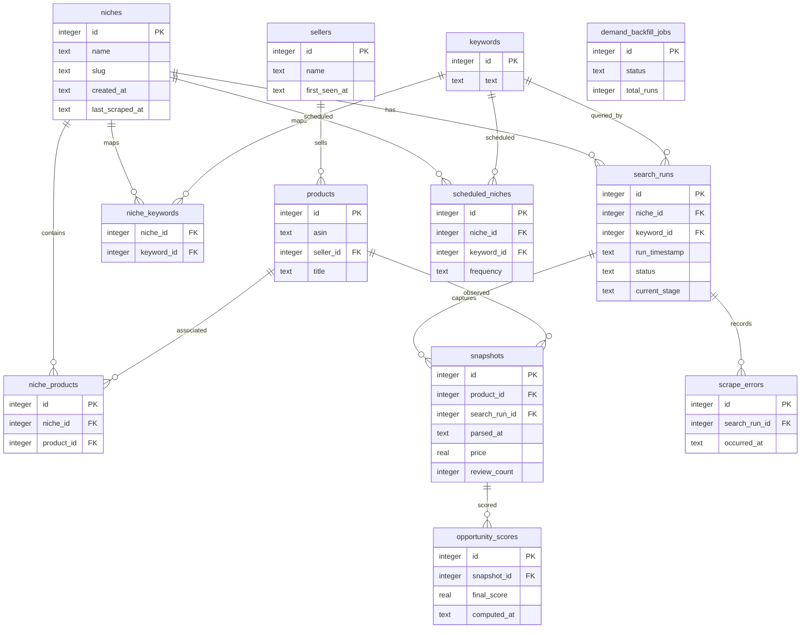

# Architecture

## Pipeline stages

`scripts/run_full_pipeline.py` is the orchestrator. It creates or resumes a `search_run_id` and calls the stages in order:

1. **Main-page scraping** — `src/scraper/search_page_scraper.py` builds Amazon India search URLs, fetches pages with `src/scraper/fetch.py`, and saves rendered HTML under `data/rendered_html/<niche>/<keyword>/<run_id>_page<N>.html`. Search pages are scheduled concurrently up to `SEARCH_PAGE_CONCURRENCY`.
2. **Product-page scraping** — `src/scraper/product_page_scraper.py` reads products found for the run, fetches detail pages, and records page-level data and errors. `MAX_DETAIL_PAGES_PER_RUN` caps the selected detail pages; `PRODUCT_PAGE_CONCURRENCY` limits simultaneous tasks.
3. **Parsing** — `scripts/run_parser.py` coordinates the search-result and product-detail parsers in `src/parser/`. It normalizes fields and writes product and snapshot records.
4. **Database storage** — `src/storage/db.py`, `src/storage/queries.py`, `src/storage/lifecycle.py`, and `src/storage/schema.sql` provide SQLite connections, queries, lifecycle cleanup, and the canonical schema. `search_run_id` links saved results, snapshots, scores, and scrape errors.
5. **Analysis and scoring** — `scripts/run_scoring.py` loads the run's niche snapshot and calls `src/analysis/scoring.py` to calculate demand, competition, quality-gap, and final scores.
6. **Completion** — the orchestrator records the final stage and returns the run ID. The command-line entry point accepts `--niche`, `--keyword`, `--pages`, `--products`, or `--run-id` with `--pages`.

The search scraper uses `SEARCH_PAGE_CONCURRENCY`; this setting is active. `MAX_RETRIES` counts total fetch attempts, including the first. A proxy CAPTCHA receives one direct retry; a persistent CAPTCHA raises `CaptchaDetectedError`.

## Storage model

The ER diagram below follows `src/storage/schema.sql` and the numbered migrations. Some later migrations add scheduling and demand-backfill tables.

`src/storage/init_db.py` creates the canonical schema and seeds migration versions. `src/storage/migrations.py` applies unrecorded numbered SQL files. Local DB files belong under `data/` and are ignored by Git.

## API

The FastAPI app is `src.storage.backend.main:app`; it mounts the scrape router from `src/storage/backend/routes/scrape.py`. The active dashboard requests `/api` paths from `nichescope-phase9/client/src/lib/api.ts`; Vite proxies them to `http://127.0.0.1:8000`.

| Method | Path |
|---|---|
| GET | `/api/health` |
| GET | `/api/dashboard` |
| GET | `/api/niches` |
| GET | `/api/niches/{niche_id}` |
| GET | `/api/niches/{niche_id}/runs` |
| GET | `/api/niches/{niche_id}/runs/{search_run_id}/opportunities` |
| GET | `/api/products` |
| GET | `/api/products/filters` |
| GET | `/api/products/{product_id}` |
| GET | `/api/products/{product_id}/history` |
| GET | `/api/products/{product_id}/price-history` |
| GET | `/api/products/{product_id}/rank-history` |
| GET | `/api/sellers` |
| GET | `/api/sellers/{seller_id}` |
| GET | `/api/runs` |
| GET | `/api/runs/{run_id}` |
| GET | `/api/errors` |
| GET | `/api/schedules` |
| DELETE | `/api/schedules/{schedule_id}` |
| GET | `/api/demand` |
| POST | `/api/demand/schedules` |
| POST | `/api/demand/backfill` |
| GET | `/api/demand/backfill` |
| GET | `/api/demand/backfill/{job_id}` |
| GET | `/api/analytics` |
| POST | `/api/scrape/start` |

The scrape-start handler validates IDs and limits, creates a run, launches the pipeline subprocess, and optionally upserts a recurring schedule. The API does not implement application login or authentication.

## Scoring and storage

- **Demand** is 70% normalized review count plus 30% normalized review velocity. Review velocity is reviews gained per day between dated observations and is computed only with at least two valid points. Histories are cut off at each product's `parsed_at`; unavailable velocity produces a missing (`None`) demand signal.
- **Competition** is `(1 - top-three review count / all review count) × 100`. All products in a niche receive the same score. If the niche has zero reviews, the current calculation returns `0`.
- **Quality gap** combines review, rating, and listing evidence using `QUALITY_REVIEW_WEIGHT`, `QUALITY_RATING_WEIGHT`, and `QUALITY_LISTING_WEIGHT` (`0.40`, `0.35`, `0.25`). The rating band is `3.3` to `4.2`, with an ideal near `3.75`. Missing rating/listing evidence can leave a signal unavailable; missing review counts are currently treated as zero.
- **Final opportunity score** uses `SCORE_WEIGHTS` (`0.4`, `0.3`, `0.3`) and renormalizes over available signals. A missing score is not substituted with zero.

Scoring behavior and defaults live in `src/analysis/scoring.py` and `src/config.py`.

## Configuration and optional integrations

The Python scraper uses constants in `src/config.py`; it does not load the root `.env`. Important defaults include `MAX_RETRIES=3` total attempts, `SEARCH_PAGE_CONCURRENCY=7`, `PRODUCT_PAGE_CONCURRENCY=10`, `MAX_DETAIL_PAGES_PER_RUN=100`, `HEADLESS=False`, `PROXY_COOLDOWN=300` seconds, and `SCORE_WEIGHTS` above. `PROXY_API_URL` points to a public free-proxy list. Proxy recovery, validation, pacing, locale, selectors, scoring thresholds, and retention settings are grouped in that module with their units and consumers.

The root `.env.example` documents optional frontend settings; it is not a Python settings file. Copy it to `nichescope-phase9/.env` only when configuring those values. `nichescope-phase9` is selected by the launcher and calls the local FastAPI service. Its Vite configuration retains optional Manus runtime and storage proxy support. The development debug collector writes browser diagnostics locally under `.manus-logs`. `BUILT_IN_FORGE_API_URL` and `BUILT_IN_FORGE_API_KEY` are read from the Vite process environment when that optional proxy is used. The retained `Map.tsx` component can load Google Maps using the configured URL/key if mounted; it is not imported by the active app. Do not put secrets in `VITE_*` values because they are compiled into client assets.

The original working-copy root `.env` contains names that are not read by current Python code. Those names are intentionally absent from `.env.example`; do not assume they provide authentication.
